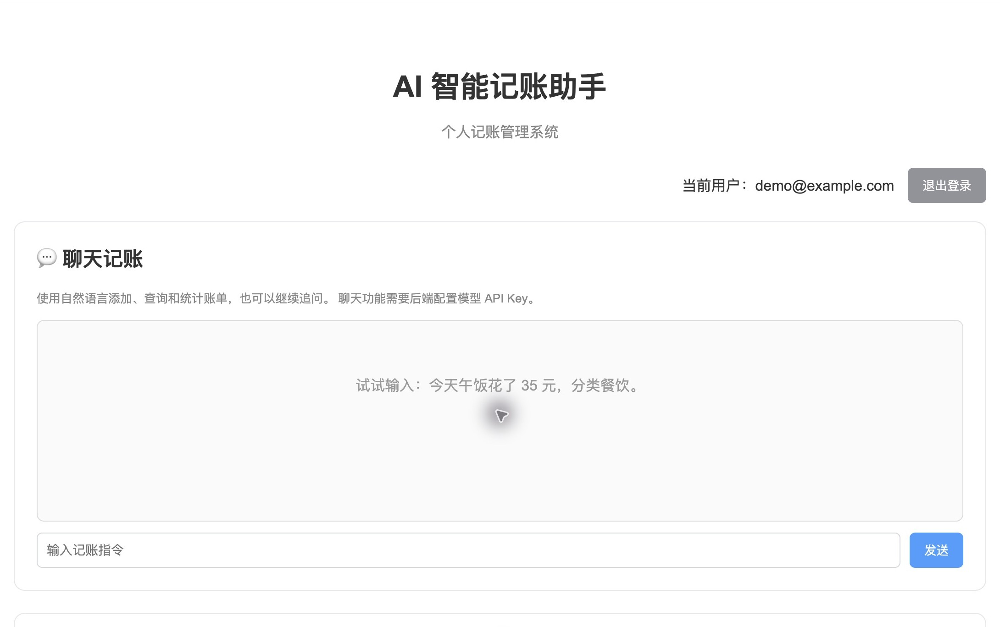
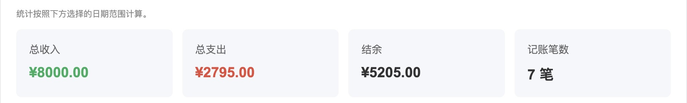
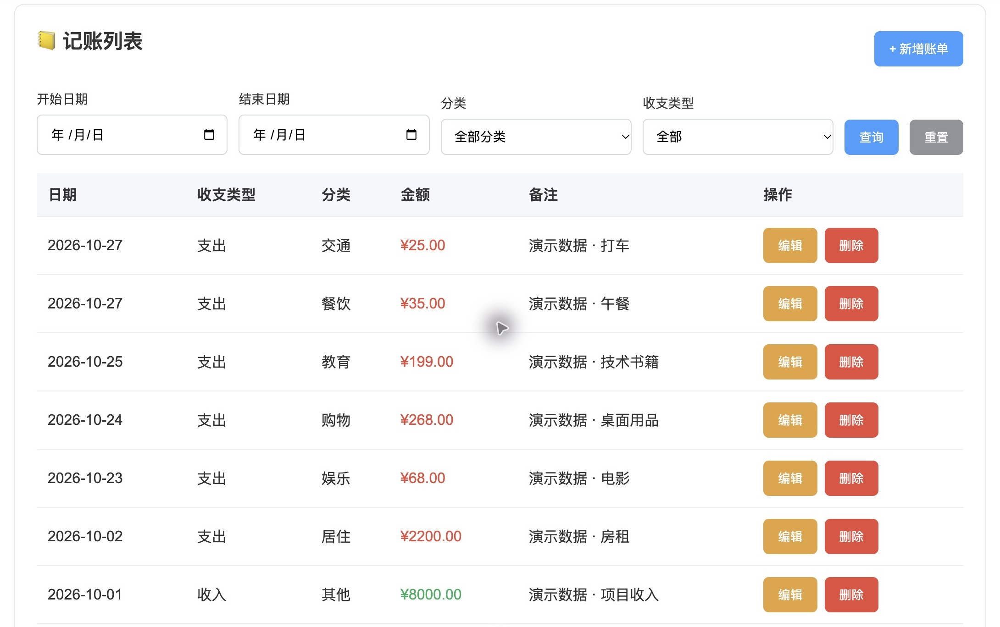
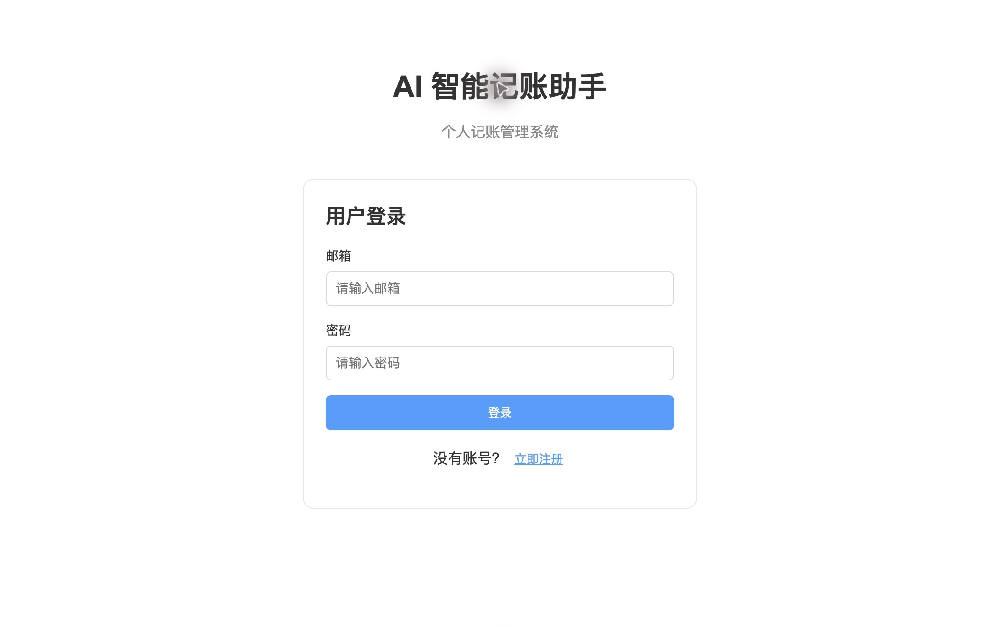
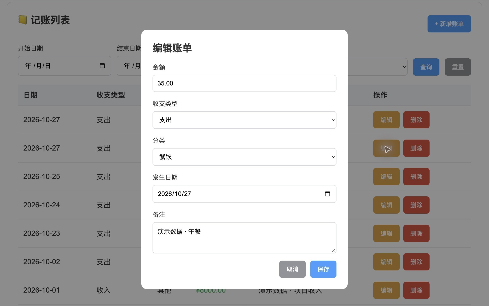
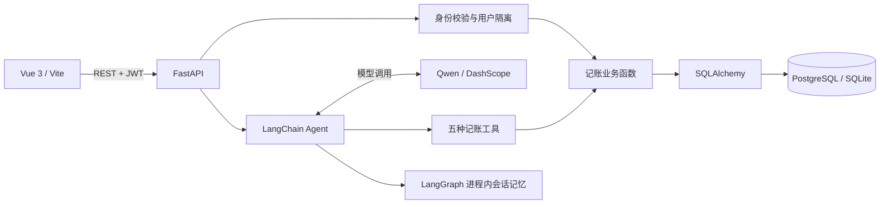

<div align="center">

# AI 智能记账助手
### 基于 Vue 3 与 FastAPI 的全栈记账项目

**Vue 3 · FastAPI · SQLAlchemy · PostgreSQL · LangChain · Qwen**

用自然语言记账，用结构化数据管理收支。

[功能概览](#功能概览) · [界面展示](#界面展示) · [技术架构](#技术架构) · [本地运行](#本地运行) · [验证与边界](#验证与边界)

</div>

## 项目简介

一个将传统账单管理与 AI 工具调用结合的全栈应用。用户可以注册和登录，管理个人收支、按条件查询账单、查看分类统计，也可以通过中文对话让智能体调用记账工具。

后端使用 FastAPI 提供接口，SQLAlchemy 管理数据库，JWT 实现身份验证；前端使用 Vue 3 构建交互界面；AI 部分通过 LangChain 接入通义千问，将用户的自然语言请求转化为受用户权限约束的业务操作。

**面向招聘者：** 本仓库集中展示前端界面、后端 API、数据模型、用户鉴权及 AI Agent 集成。重点代码位于 [backend/main.py](backend/main.py)、[backend/agent_service.py](backend/agent_service.py) 和 [frontend/src/App.vue](frontend/src/App.vue)。

**项目目标：** 将自然语言交互与结构化账单管理结合，让用户既能通过表单准确录入收支，也能用日常语言完成记账、查询和统计。本项目覆盖前端交互、后端接口、数据库操作、用户认证及智能体工具调用，展示一条完整的全栈开发流程。

> 这是源码作品页，未提供公网在线服务。界面截图来自本地运行的真实应用，账号和账单均为专门生成的演示数据。

## 功能概览

| 功能 | 实现内容 |
| --- | --- |
| 账号与鉴权 | 邮箱注册、密码校验、Argon2 密码哈希、JWT 登录和受保护接口 |
| 账单管理 | 收入/支出新增、编辑、删除；金额、分类、日期和备注校验 |
| 条件查询 | 日期区间、分类、收支类型筛选和分页 |
| 收支分析 | 总收入、总支出、结余、笔数、分类支出及占比 |
| 对话记账 | Qwen + LangChain 调用添加、修改、查询、删除、统计五种工具 |
| 用户数据隔离 | 从 JWT 解析用户身份，数据库操作按 `user_id` 限定范围 |
| 连续对话 | 按用户划分 LangGraph 会话，支持上下文指代；记忆保存在进程内 |

可尝试的对话指令（需配置模型服务）：

- “今天午饭花了 35 元，分类餐饮。”
- “将刚才那笔改为 38 元。”
- “查询这个月的交通支出。”
- “统计这个月各分类的支出占比。”

## 界面展示

### 收支管理总览

下图为桌面浏览器中的真实运行界面。聊天区为初始状态，没有伪造模型回复；完整功能还包括下方的收支统计与分类占比。



### 收支汇总



### 筛选与账单管理



<details>
<summary><strong>查看登录界面与账单编辑界面</strong></summary>

#### 用户登录



#### 账单编辑



</details>

## 技术架构



- **统一业务逻辑：** 表单接口和智能体工具复用同一组业务函数，减少两条操作路径的行为差异。
- **身份由服务端确定：** 工具闭包绑定已登录用户 ID，模型无需提供用户身份。
- **结构化验证：** Pydantic 检查输入，金额使用 `Decimal` 和数据库 `Numeric(12, 2)`。
- **模型与浏览器分离：** 模型 API Key 只在后端读取，不进入前端构建产物。
- **便于本地复现：** 提供无密钥配置模板；账单功能可用 SQLite 独立运行，PostgreSQL 作为另一种数据库配置。

## 目录结构

```text
ai-accounting-assistant/
├── backend/
│   ├── main.py                 # API、鉴权、模型与记账业务
│   ├── agent_service.py        # Qwen Agent 与五种工具
│   ├── tests/test_api.py       # API 回归测试
│   ├── .env.example            # 后端配置模板，不包含密钥
│   ├── pyproject.toml
│   └── uv.lock
├── frontend/
│   ├── src/App.vue             # 登录、聊天、统计、账单页面
│   ├── .env.example            # 后端地址配置
│   ├── package.json
│   └── package-lock.json
└── docs/
    ├── screenshots/            # 真实应用截图，全部为演示数据
    └── PROJECT_NOTES.md        # 来源、验证记录与改进方向
```

## 本地运行

需要 Python **3.11–3.14**、`uv`、Node.js **22.18+（22.x）或 24.12+** 和 npm。以下命令适用于 macOS/Linux，在项目根目录执行。

### 1. 启动后端

```bash
cd backend
uv sync --locked
cp .env.example .env
uv run python -c "import secrets; print(secrets.token_urlsafe(48))"
```

把生成的随机值填写到本机 `backend/.env` 的 `SECRET_KEY=` 后面，再启动：

```bash
uv run uvicorn main:app --reload --host 127.0.0.1 --port 8000
```

默认模板使用 SQLite，在本机创建 `accounting.db`。无需配置模型 Key 即可使用注册、登录、账单管理和统计功能。交互式 API 文档位于 `http://127.0.0.1:8000/docs`。

如需使用 PostgreSQL，先创建数据库，再将 `DATABASE_URL` 改为 `postgresql+psycopg://<user>:<password>@localhost:5432/<database>`，并用自己的配置替换占位符。应用启动时创建数据表。

### 2. 启动前端

另开一个终端，在项目根目录执行：

```bash
cd frontend
npm ci
cp .env.example .env
npm run dev
```

打开 `http://localhost:5173`，注册账号后即可使用。注册密码需至少 8 位，包含大小写字母、数字和特殊字符。

### 3. 启用 AI 对话（可选）

在 `backend/.env` 中填写自己的 `DASHSCOPE_API_KEY`，并核对 `DASHSCOPE_BASE_URL` 与 `QWEN_MODEL` 是否适用于你的模型服务账号，然后重启后端。模型调用需要网络连接，会使用该账号的模型额度。

`.env`、数据库文件和依赖目录均被 Git 忽略。不要将任何真实密钥放入 `VITE_*` 变量，前端变量会暴露在浏览器中。

## API 一览

| 方法 | 路径 | 作用 |
| --- | --- | --- |
| POST | `/api/auth/register` | 注册 |
| POST | `/api/auth/login` | 登录，返回 JWT |
| GET | `/api/auth/me` | 当前用户 |
| POST / GET | `/api/records` | 新增 / 查询账单 |
| PUT / DELETE | `/api/records/{record_id}` | 修改 / 删除账单 |
| GET | `/api/statistics` | 收支及分类统计 |
| POST | `/api/chat` | 对话记账 |

除注册、登录和首页外，上表接口需要 `Authorization: Bearer <token>`。

## 验证与边界

已执行前端生产构建和 **5 项后端 API 回归测试**，覆盖鉴权、增删改查与统计、筛选分页、非法输入、跨用户访问隔离。测试使用临时 SQLite 数据库和虚构账号，不连接个人数据库、不调用模型。

```bash
# 后端：在 backend/ 中执行
uv run --with httpx python -m unittest discover -s tests -v

# 前端：在 frontend/ 中执行
npm run build
```

本次作品整理未重新验证真实 Qwen 调用或 PostgreSQL 连接。AI 集成代码已包含在仓库中，实际响应取决于模型服务配置和网络情况。

这是学习与求职展示项目。公网部署前仍需补充限流、模型调用预算、数据库迁移、监控及自动化部署；对话记忆在进程重启后丢失。当前删除确认主要依赖前端确认框和智能体提示词，AI 工具层尚未实现独立的二次确认协议。JWT 存储在浏览器 localStorage，后续可进一步评估会话安全方案。

更多细节见 [项目说明与验证记录](docs/PROJECT_NOTES.md)。
